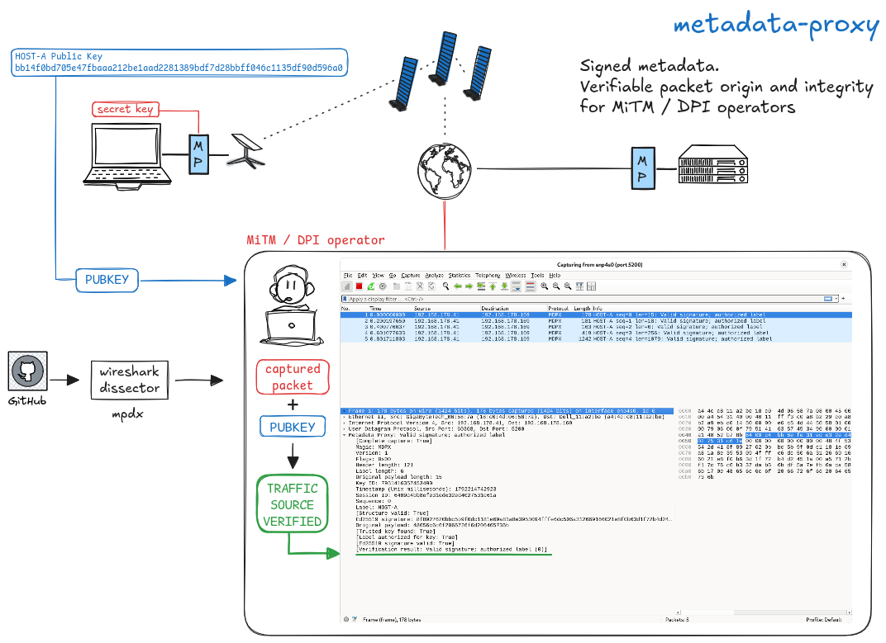
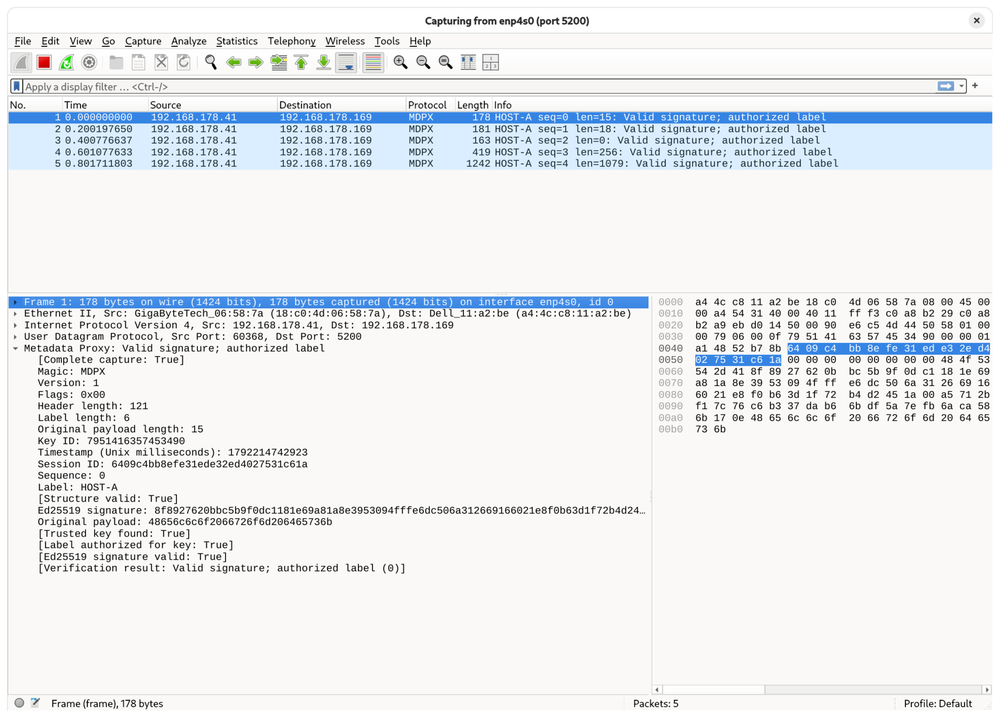

# metadata-proxy



The primary purpose is to make the asserted source of UDP traffic visible and
cryptographically verifiable to both the destination and independent observers.
Cleartext metadata enables visual inspection; an Ed25519 signature on **every
encapsulated datagram** lets any observer with a trusted public key verify that
the key holder endorsed the metadata and exact payload. Remote-end authentication
is one use of this proof; third-party verification is also a primary use case.

The implementation is a minimal single-threaded Linux UDP proxy in C11 using
libsodium Pure Ed25519. The receiving proxy authenticates the metadata and
payload, checks freshness and a 1024-packet replay window, then forwards the exact
original payload in one datagram, including empty datagrams. Normal UDP sockets
require neither root nor TUN, raw sockets, or firewall changes.

## Independent observers and verifiable source

A DPI operator monitoring a traffic stream, a passive capture system, or an
on-path intermediary (including an observer in a MiTM position) can inspect the
visible label and independently verify the packet signature. Multiple observers
can verify the same packet without sharing a secret, contacting the receiver,
participating in forwarding, or decrypting the original payload.

```text
Source signing proxy -------- signed UDP packet --------> Receiving proxy
                                  |            |
                             Observer A    Observer B
                             visual label + signature verification
                             using trusted published public keys
```

For example, publish dell's public key and establish a trusted association
between that key, the label `HOST-B`, and the identified host `dell`
(`192.168.178.169`). A DPI operator can then verify packets attributed to that
identity and apply its own policy for an approved source. The operator needs only
the public key and authorization mapping; the private signing seed stays on dell.
Public-key publication alone does not establish identity: the observer must
obtain or validate the key-to-host/label association through a trusted channel.
Key distribution, enrollment, rotation, and revocation are managed outside v1.

There are two distinct levels of inspection:

- **Visual inspection:** read `HOST-B` and other cleartext metadata. Until the
  signature is checked, these are unverified claims that anyone could imitate.
- **Cryptographic verification:** verify the signature over all metadata and the
  exact original payload using the trusted public key, and check that the key is
  authorized for the label. This establishes integrity and endorsement by that
  key holder. Whether the identified source is approved is the observer's policy.

Here, “verifiable source” means attribution to the holder of a trusted signing
key. Original IP/UDP addresses and ports are outside the signature. A trusted
inventory may associate a key with an addressable host, but the signature does
not bind the observed source IP address or prove physical origin, network path,
original application identity, clock correctness, or absence of relaying.
Anyone able to submit to an encapsulation listener can ask it to endorse data;
examples bind that listener to loopback.

Each observer can independently verify authenticity. Claims about freshness or
duplicate observations additionally require its own clock policy and replay
state. A stateless signature check cannot establish that a packet has never been
seen elsewhere, or that the destination accepted or received it.

This prototype uses fixed peers and forwarding destinations and adds no
encryption. Metadata is visible, clear RTP stays clear, and already encrypted
WireGuard payloads stay opaque while their signatures remain verifiable. An
observer needs the complete MDPX UDP payload, including the original payload
bytes, to verify the signature; metadata alone is insufficient. An additional
encrypted tunnel around the entire MDPX packet would hide it from observers
outside that tunnel.

Observers can use `inspect` for one exported UDP payload or the optional
[native Wireshark dissector](wireshark/README.md) for packet captures and live
Wireshark observation. The dissector performs real Ed25519 verification with a
configured public-key trust file and exposes filterable verification results.
A standalone DPI service or multi-observer collection service is not implemented;
independent verifiers can implement the format in [PROTOCOL.md](PROTOCOL.md).

## Build and check

On Debian 13 amd64, first check the existing packages:

```sh
cc --version
pkg-config --modversion libsodium
# If dependencies are missing:
sudo apt-get install build-essential pkg-config libsodium-dev
make
make test
make sanitize
make clean
make
```

The production binary requires only libc and libsodium. Tests/harness use
Python 3; optional `python3-cryptography` cross-checks a fixed fixture against
an independent OpenSSL-backed Ed25519 implementation. The fixed public test
seed is deliberately non-secret. Production secrets must not be committed.
Tests have timeouts and clean up processes. IPv6 unavailability and socket
sandbox restrictions produce explicit skips. `make sanitize` uses ASan/UBSan;
when LeakSanitizer cannot run under a tracer, use
`ASAN_OPTIONS=detect_leaks=0 make sanitize` (this disables leak checking only).

`CC`, `CPPFLAGS`, `CFLAGS`, `LDFLAGS`, `LDLIBS`, and `PKG_CONFIG` are overridable.
For a Buildroot SDK, point CC and PKG_CONFIG at the target SDK tools and provide
its sysroot flags. No host architecture assumptions, packed structs, custom
cryptography, or per-packet heap allocations are used. Linux socket options
request no fragmentation; non-Linux ports need a corresponding policy.

## Keys and trust

```sh
./metadata-proxy keygen --secret host-a.secret --public host-a.public
./metadata-proxy keygen --secret host-b.secret --public host-b.public
awk '{print $0 " HOST-A"}' host-a.public > trust-a.txt
awk '{print $0 " HOST-B"}' host-b.public > trust-b.txt
```

Key files are exactly 64 lowercase hex characters plus newline: a 32-byte
Ed25519 **seed** for the secret file and a raw 32-byte public key. The 64-byte
libsodium signing secret is derived at startup and erased on normal cleanup.
New secret files are exclusively created with mode 0600; existing files are
never overwritten. If the second file cannot be created, the first remains;
resolve that partial creation explicitly before retrying.

Trust entries are `PUBLIC_KEY_HEX LABEL`, one per line, with blank lines and
whole-line `#` comments. Multiple labels may use the same key. Authorization is
case-sensitive; labels are 1–63 bytes of `[A-Za-z0-9._-]`. Trust is bounded to
4096 entries and malformed lines fail startup. Key IDs are lookup hints derived
locally; distinct public keys with colliding IDs are rejected. Incoming keys
are never accepted as trust roots.

## Two-host topology

Host A is `desk` (`192.168.178.41`); host B is `dell` (`192.168.178.169`).
The key names and labels from the setup above map HOST-A to desk and HOST-B to
dell. Copy `trust-a.txt` to dell and `trust-b.txt` to desk through a trusted
channel. Keep `host-a.secret` on desk and `host-b.secret` on dell.
Each application must send to port 5100 and receive on a **separate** port 5101.
The outer network listeners use UDP port 5200. There are four proxy processes:

On desk (`192.168.178.41`):

```sh
./metadata-proxy encap --listen 127.0.0.1:5100 --peer 192.168.178.169:5200 \
  --label HOST-A --secret host-a.secret
./metadata-proxy decap --listen 192.168.178.41:5200 --forward 127.0.0.1:5101 \
  --trust trust-b.txt
```

On dell (`192.168.178.169`):

```sh
./metadata-proxy encap --listen 127.0.0.1:5100 --peer 192.168.178.41:5200 \
  --label HOST-B --secret host-b.secret
./metadata-proxy decap --listen 192.168.178.169:5200 --forward 127.0.0.1:5101 \
  --trust trust-a.txt
```

Applications need to support that explicit port mapping. IPv6 endpoints must
be bracketed; using documentation-only IPv6 addresses, for example, `--listen '[::1]:5100' --peer '[2001:db8::20]:5200'` and
`--listen '[2001:db8::10]:5200' --forward '[::1]:5101'`. Endpoints are resolved
at startup, with the first usable address selected; no runtime discovery occurs.
Each sender start creates a fresh random session ID. Each direction signs
independently, even if one public key is authorized for both labels.

These commands do not implement arbitrary clients, dynamic replies, transparent
routing, or automatic WireGuard endpoint learning. WireGuard normally sends and
receives through one endpoint socket; using these processes with real WireGuard
requires an additional carefully designed socket multiplexer/address mapping
layer so returning traffic has the expected local endpoint. That is future work.
Original IP/UDP headers, addresses, ports, TTL, and checksums are not preserved.

All interfaces are listed by `./metadata-proxy --help`. Common settings:

- `--max-datagram 1200`: total outer UDP payload cap, valid 116..65507;
  the selected label must fit. Decap enforces this too.
- `--stats-interval 5`: cumulative reports every five seconds; 0 disables
  periodic reports. SIGINT/SIGTERM still print a final report.
- Decap: `--max-age-ms 30000 --future-skew-ms 5000 --max-sessions 1024`.
  The session cap can be 1..65536; new sessions are rejected when full.

## Size and path MTU

The wrapper is `115 + label_length` bytes. HOST-A adds 121 bytes, leaving
1079 original bytes under the default 1200-byte outer cap. At IP MTU 1500,
without IPv4 options/IPv6 extension headers, the original budgets are:

| Network | Arithmetic | Original bytes |
|---|---|---:|
| IPv4 | 1500 − 20 − 8 − 121 | 1351 |
| IPv6 | 1500 − 40 − 8 − 121 | 1331 |

WireGuard's own encapsulation further reduces its inner interface MTU.
1200 is conservative, not a universal path guarantee. Linux sockets request
`IP_PMTUDISC_DO` / `IPV6_MTU_DISCOVER` with the corresponding no-fragment mode.
There is no automatic PMTU adaptation: EMSGSIZE counts as a send failure.
Oversize input is counted and discarded; truncated recvmsg input is never
forwarded. There is no splitting, smaller retry, retransmission, or unsigned
fallback. Linux may still reassemble fragmented incoming IP packets before UDP.

## Freshness, replay, and clocks

Wire timestamps use CLOCK_REALTIME Unix milliseconds, checked against receiver
time with inclusive age/skew boundaries and overflow-safe comparisons. Clocks
must be reasonably synchronized. Unusable local realtime is a fatal error.
Durations and statistics scheduling use CLOCK_MONOTONIC.

After structural validation, authorization and signature verification, the
receiver checks freshness, then updates replay state **before** sending. State
is keyed by full trusted public key and session ID. A 1024-bit sliding window
accepts unseen reordered sequences; duplicates and sequences older than the
window are dropped. A sender stops before sequence wrap. Failed sends can leave
gaps. Session retention uses the largest accepted timestamp, never an older
reordered timestamp, and expires only when `now > latest + max_age` using safe
subtraction. Expired entries can be reclaimed; live entries are never evicted.

A forward clock step can expire sessions and reject packets as stale. A backward
step can reject packets as future and prolong session retention. Following an
expiration and later backward clock step, a still-signed packet may again appear
fresh without its old replay state. Restart also discards state and can permit
replays inside the freshness window. There is no persistence. Stateless observers
cannot prove a captured packet has never appeared elsewhere.

## Capture and inspect



For integrated Wireshark verification, build the optional plugin with
`make wireshark`, install `wireshark/mdpx.so` in Wireshark's personal versioned
`epan` plugin folder, then set **Preferences → Protocols → MDPX → Public-key
trust file**. See [Wireshark setup and filters](wireshark/README.md) for exact
commands. Use a combined trust file for both desk and dell. The plugin does not
require or use private signing keys.

`inspect` reads exactly one outer UDP payload (not pcap), checks the wrapper,
trust and signature, and reports timestamp and informational default freshness.
It does not enforce offline age or claim replay protection. Observers use their
own trusted key/label mappings; they do not need the receiving proxy or its
private configuration. For the dell → desk direction, use `trust-b.txt` instead
of `trust-a.txt` below. Example extraction
of one frame with tshark (choose the relevant frame/filter explicitly):

```sh
tshark -r capture.pcapng -Y 'frame.number == 42 && udp.dstport == 5200' \
  -T fields -e udp.payload | tr -d ':\n' | xxd -r -p > packet.bin
./metadata-proxy inspect --packet packet.bin --trust trust-a.txt
```

Do not concatenate payloads from multiple frames. A signature-valid but old
packet can be inspected successfully; forwarding would still reject it.

## Accounting and measurement

Counters are 64-bit and cumulative. Input packets/bytes count recvmsg results
before validation (Linux MSG_TRUNC reports full received size). Oversize and
truncation may both count one packet. Rejection counters follow the first failing
stage: parse, unknown key, unauthorized label, invalid signature, stale/future,
replay, session cap. Forwarded packets/bytes count successful `send`, including
wrapper bytes in encap and only original bytes in decap; success does not prove
delivery. Socket errors, send failures and kernel receive drops are separate.
SO_RXQ_OVFL reports receive drops where supported; its cumulative 32-bit kernel
value is accumulated into 64 bits, and drops without a later received notification
cannot be observed. Socket buffers retain OS defaults. There is no per-packet
logging or production latency instrumentation.

See [PROTOCOL.md](PROTOCOL.md) for the exact wire format and
[BENCHMARKS.md](BENCHMARKS.md) for methodology, results and limitations.

```sh
make bench
./metadata-proxy bench --seconds 1 --sizes 0,64,160,512,1024
python3 tools/e2e.py                         # 30 seconds, three repeats
python3 tools/e2e.py --seconds 1 --repeats 1 # smoke test
```

The benchmark-only plain relay lives in `tools/udp-traffic`, never in the
production protocol. No signature batching, encryption, certificates, handshake,
fragmentation/reassembly, discovery, daemonization, or replay persistence is
implemented. The current replay-table lookup scans the configured session table;
measure with expected session counts before choosing a deployment cap.
